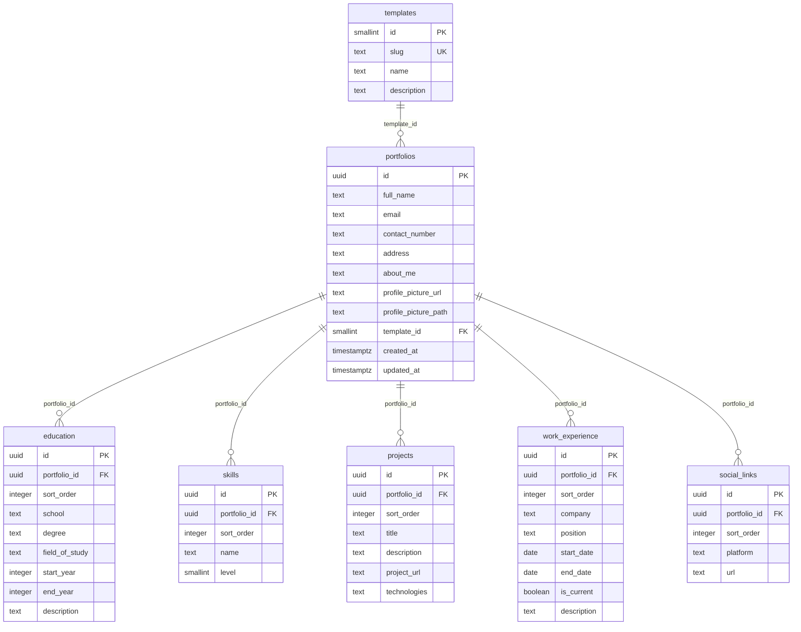
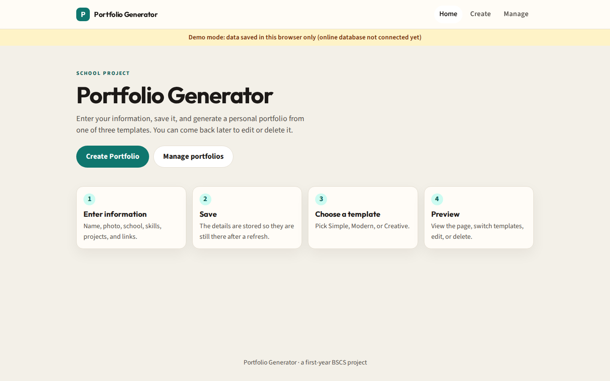
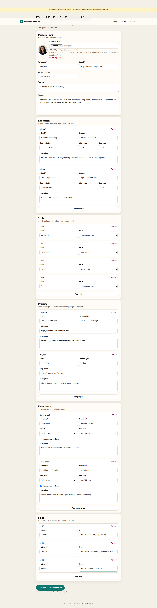
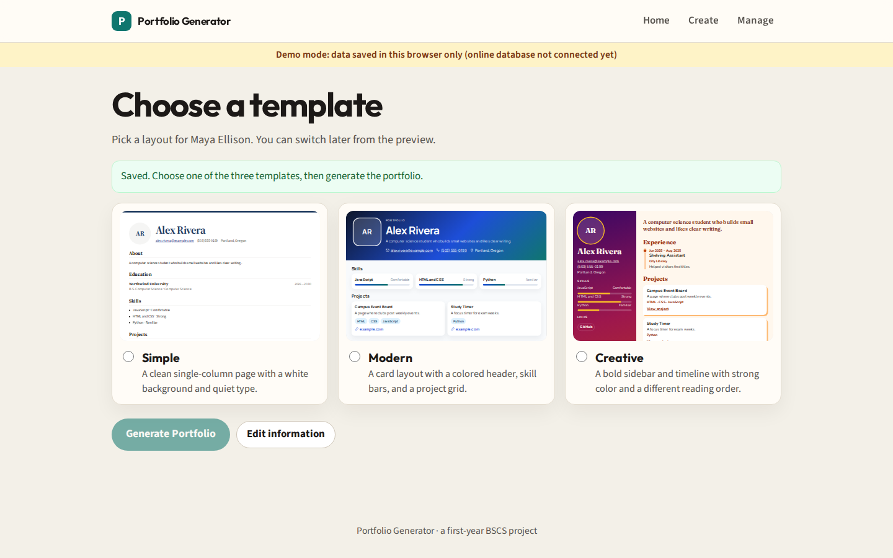
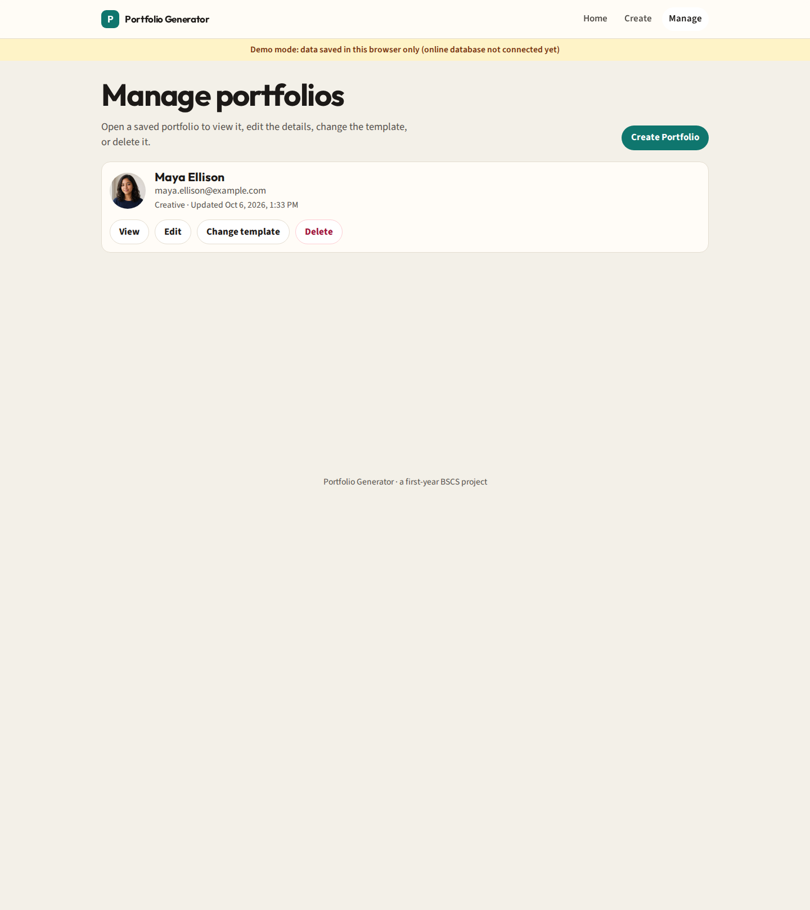
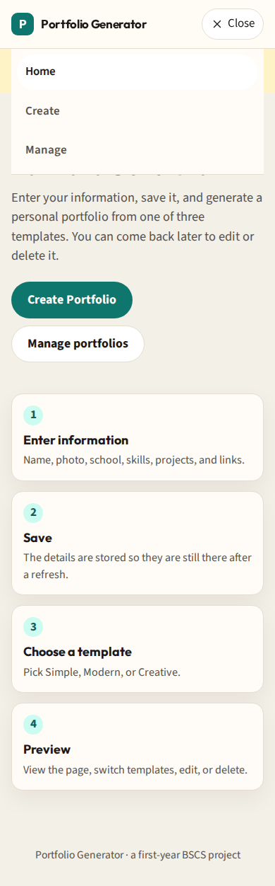
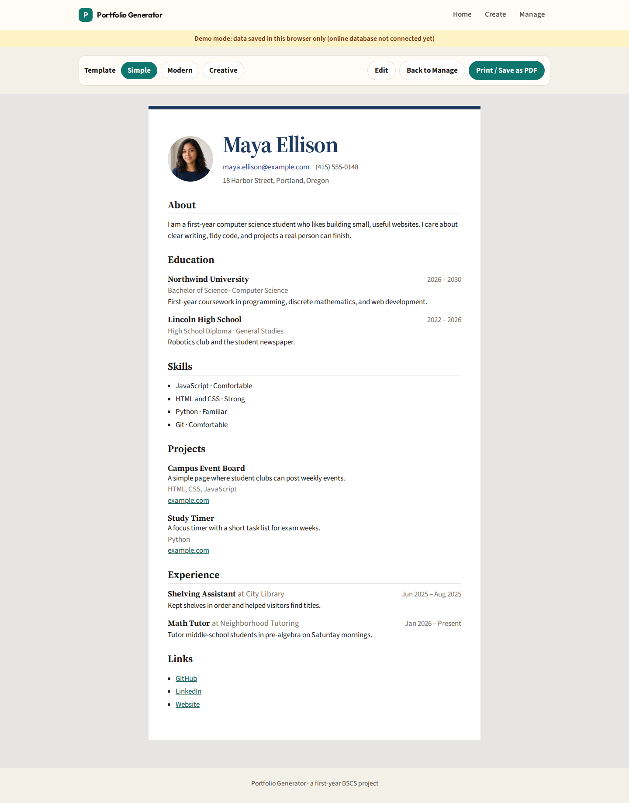
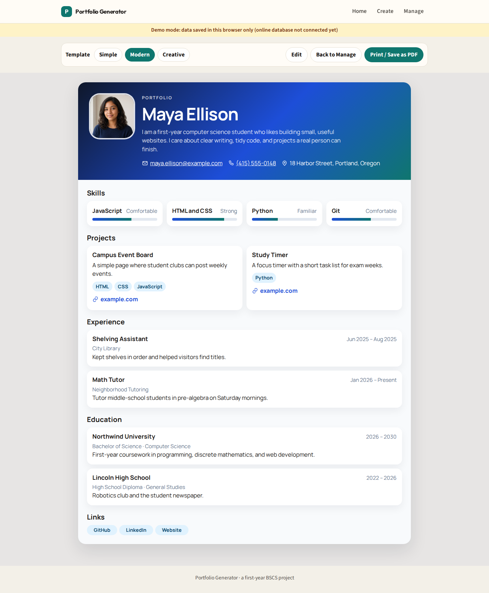
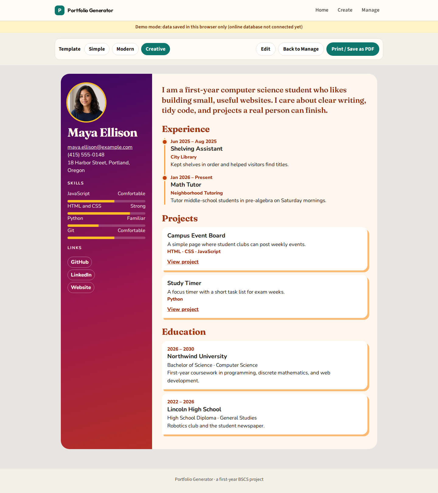
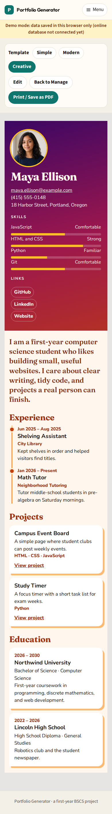

# Portfolio Generator

## Project Title

Portfolio Generator

## Project Description

Portfolio Generator is a website that lets a student enter personal information, save it, choose one of three portfolio templates, and generate a portfolio page. The user can preview the page, switch templates, edit the information, or delete the portfolio.

The pages follow this order:

Home → Create Portfolio → Enter Information → Save → Select 1 of 3 Templates → Generate → Preview → Edit / Delete

Until the online database is connected, the site runs in demo mode and keeps data in the browser. After the Supabase environment variables are set, the same website saves to PostgreSQL and stores the profile picture in Supabase Storage. The yellow demo banner disappears when that connection is active.

## Technologies Used

- React with TypeScript
- Vite
- React Router
- CSS
- Supabase JavaScript client
- Supabase PostgreSQL and Supabase Storage
- Vercel

## Database Platform

Supabase (PostgreSQL) / Database Project: Portfolio Generator

No passwords, API secret keys, or private credentials are stored in this project. The published site uses the public anon key, which is set in the hosting environment and is not written in the repository.

Paste `supabase/setup_all.sql` once in the Supabase SQL Editor. It creates the tables and the profile-picture bucket. The same SQL is also split into `supabase/migrations/0001_init.sql` and `supabase/storage.sql`.

This assignment has no login. Row Level Security is turned on for every table, and the policies allow the anon role to add, read, update, and delete portfolio data so the instructor can test the site. The templates table is read-only. This is a class-project tradeoff, not a setup for a real public product.

## Hosting / Deployment Platform

Vercel

The site is a static single-page app. `vercel.json` sends every route to `index.html`. The build command is `npm run build` and the output folder is `dist`.

## Database Structure

The information is split across a header table and child tables so repeated items (schools, skills, projects, jobs, and links) are not packed into one column.

### templates

| Column | Type | Keys and rules |
| --- | --- | --- |
| id | smallint | Primary key. Seeded as 1, 2, and 3 |
| slug | text | Unique. Only `simple`, `modern`, or `creative` |
| name | text | Required |
| description | text | Required |

### portfolios

| Column | Type | Keys and rules |
| --- | --- | --- |
| id | uuid | Primary key, default `gen_random_uuid()` |
| full_name | text | Required, 1–120 characters |
| email | text | Required, email format |
| contact_number | text | Optional, 3–40 characters |
| address | text | Optional, up to 300 characters |
| about_me | text | Optional, up to 4000 characters |
| profile_picture_url | text | Optional public URL of the photo |
| profile_picture_path | text | Optional path inside the storage bucket |
| template_id | smallint | Foreign key to `templates.id`. Empty until a template is chosen |
| created_at | timestamptz | Required, default now |
| updated_at | timestamptz | Required. A trigger sets this on every update |

### education

| Column | Type | Keys and rules |
| --- | --- | --- |
| id | uuid | Primary key |
| portfolio_id | uuid | Foreign key to `portfolios.id`, `ON DELETE CASCADE` |
| sort_order | integer | Required. Form order, starting at 0 |
| school | text | Required |
| degree | text | Optional |
| field_of_study | text | Optional |
| start_year | integer | Optional, 1950–2100 |
| end_year | integer | Optional, 1950–2100, not earlier than the start year |
| description | text | Optional |
| created_at | timestamptz | Required |

### skills

| Column | Type | Keys and rules |
| --- | --- | --- |
| id | uuid | Primary key |
| portfolio_id | uuid | Foreign key to `portfolios.id`, `ON DELETE CASCADE` |
| sort_order | integer | Required |
| name | text | Required |
| level | smallint | Optional, 1 (beginner) through 5 (advanced) |
| created_at | timestamptz | Required |

### projects

| Column | Type | Keys and rules |
| --- | --- | --- |
| id | uuid | Primary key |
| portfolio_id | uuid | Foreign key to `portfolios.id`, `ON DELETE CASCADE` |
| sort_order | integer | Required |
| title | text | Required |
| description | text | Optional |
| project_url | text | Optional. Must start with `http://` or `https://` |
| technologies | text | Optional. Comma-separated list, for example `HTML, CSS, JavaScript` |
| created_at | timestamptz | Required |

### work_experience

| Column | Type | Keys and rules |
| --- | --- | --- |
| id | uuid | Primary key |
| portfolio_id | uuid | Foreign key to `portfolios.id`, `ON DELETE CASCADE` |
| sort_order | integer | Required |
| company | text | Required |
| position | text | Required |
| start_date | date | Optional |
| end_date | date | Optional. Empty when the job is current |
| is_current | boolean | Required, default false |
| description | text | Optional |
| created_at | timestamptz | Required |

### social_links

| Column | Type | Keys and rules |
| --- | --- | --- |
| id | uuid | Primary key |
| portfolio_id | uuid | Foreign key to `portfolios.id`, `ON DELETE CASCADE` |
| sort_order | integer | Required |
| platform | text | Required. Example: GitHub, LinkedIn, Website |
| url | text | Required. Must start with `http://` or `https://` |
| created_at | timestamptz | Required |

Each child table has an index on `portfolio_id`. `portfolios.template_id` is indexed as well.

### Storage

Bucket name: `profile-pictures` (public, 2 MB limit, JPEG, PNG, WEBP, and GIF). The anon role can read, upload, replace, and delete files in that bucket only.

### Entity relationship

## System Flow

1. The home page introduces the site and offers **Create Portfolio**.
2. The information form collects personal info, education, skills, projects, experience, and links. Name and email are required. The photo is checked for type and size.
3. Saving writes the portfolio through the data layer, then opens template selection.
4. The user picks Simple, Modern, or Creative. **Generate Portfolio** stores that choice and opens the preview.
5. The preview reads the portfolio from the saved id in the URL (`/portfolio/:id`), so a refresh still shows it.
6. From the preview, the user can switch templates, edit, go back to Manage, or print / save as PDF.
7. Manage lists every saved portfolio and can view, edit, change the template, or delete it. Delete asks for confirmation.

Empty sections are hidden on all three templates.

## Screenshots of the System

These screenshots were taken in demo mode, so the yellow database banner is visible. After Supabase is connected and the site is redeployed, that banner is hidden.

## Screenshots of the 3 Templates

## Published Website URL

`https://<your-project>.vercel.app`

Replace this with the real Vercel URL after deployment.
